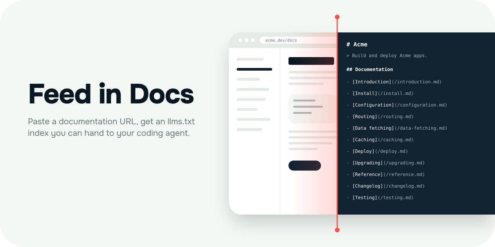

<p align="center">
  
</p>

<p align="center">
  <a href="https://feed-in-docs.vercel.app">Live app</a> ·
  <a href="#how-it-works">How it works</a> ·
  <a href="#api">API</a> ·
  <a href="#run-locally">Run locally</a>
</p>

# Feed in Docs

Paste a documentation URL and get an [`llms.txt`](https://llmstxt.org) index you can hand to a coding agent, as a shareable link or as text. It lists the real pages of a docs site with a one-line description of each, so the agent stops guessing at URLs. Most docs sites don't publish this file, so Feed in Docs crawls the site and writes one. There's no account and no page cap.

> [!NOTE]
> **An index, not a copy.** The result holds links and descriptions, and your agent still fetches the pages it needs.
>
> The crawler doesn't run JavaScript and doesn't read `robots.txt`. A site that builds its navigation in the browser and has no sitemap yields few pages. Treat the page count as what the crawler could reach, not the size of the docs.

## How it works

The graphic above is the whole idea. On one side of the line is the site as a person reads it, and on the other is the same site as an agent needs it.

1. **Docs.** The crawler stays on the URL's origin and inside one section. If the path has a `docs` or `documentation` segment, the section ends there, so `/en/docs/guides/intro` covers `/en/docs/`. Otherwise it's the parent directory, so `/guide/intro` covers `/guide/`.
2. **Crawl.** It reads `/sitemap.xml` and any nested sitemaps, then follows links from each page. A site with no sitemap still works through links alone. A page that can't be read is counted and skipped, but if the URL you entered fails, the whole run fails.
3. **llms.txt.** Each page becomes one line. The title comes from the first `h1`, then `<title>`. The description comes from the meta description, then the first paragraph, cut to 180 characters. If a page declares a same-origin `<link rel="alternate" type="text/markdown">`, the entry links to that file and not the HTML page.

## Output

Copy the link, copy the text, or download it as `llms.txt`:

```markdown
# Acme

> Build and deploy Acme apps.

## Documentation

- [Introduction](https://acme.dev/docs): Build and deploy Acme apps.
- [Getting started](https://acme.dev/docs/getting-started.md): Install the CLI and deploy your first app.
- [Configuration](https://acme.dev/docs/configuration): Every option in acme.config.ts.
```

## Links

Each result is saved to a private [Vercel Blob](https://vercel.com/docs/vercel-blob) store and served at `/l/<id>/llms.txt`. Anyone with the link can read the file. The ID comes from the documentation URL, so generating the same docs again refreshes the existing link. If the save fails, you still get the text, just no link.

## API

```sh
curl -X POST https://feed-in-docs.vercel.app/api/generate \
  -H "Content-Type: application/json" \
  -d '{"url": "https://tailwindcss.com/docs"}'
```

The response is `{ "text": "...", "count": 180, "failed": 2, "link": "https://..." }`, where `text` is the index, `count` is the pages indexed, `failed` is the pages it couldn't read, and `link` is the shareable URL, or `null` if the save failed. Any error returns HTTP 400 with `{ "error": "..." }`.

## Limits

The crawler makes 8 requests at a time, gives each one 8 seconds, and follows up to 3 same-origin redirects. Pages can be up to 1 MB and sitemaps up to 10 MB.

It rejects localhost, private IP addresses, and URLs with an explicit port or credentials. This keeps the server from being pointed at internal hosts, and it means you can't index a docs site running on your own machine.

The API route doesn't set `maxDuration`, so on Vercel your plan's default function limit applies. A very large site can hit it before the crawl finishes.

## Run locally

You need Node.js 20.9 or newer and pnpm, which `corepack` provides.

```sh
git clone https://github.com/joaovitorscr/feed-in-docs.git && cd feed-in-docs
corepack enable
pnpm install
pnpm dev
```

Open http://localhost:3000. No environment variables are required to generate text.

- `BLOB_READ_WRITE_TOKEN` turns on shareable links. Without it, the app returns no link.
- `NEXT_PUBLIC_SITE_URL` is your deployment's URL, used in metadata, `robots.txt`, and the sitemap. It defaults to `https://feed-in-docs.vercel.app`.

## Development

```sh
pnpm lint
pnpm format:check
pnpm typecheck
pnpm build
pnpm check:react-doctor
```

CI runs `lint`, `format:check`, `typecheck`, and `check:react-doctor` on every PR. `pnpm install` also sets up a pre-push hook that runs the same four.

The crawler and the `llms.txt` writer are in `lib/generate.ts`, and link storage is in `lib/links.ts`. The UI is `app/page.tsx`. `app/api/generate/route.ts` is the endpoint, and `app/l/[id]/llms.txt/route.ts` serves saved files.
