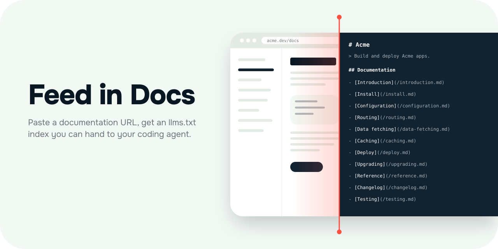

<p align="center">
  
</p>

<p align="center">
  <a href="https://feed-in-docs.vercel.app">Live app</a> ·
  <a href="#how-it-works">How it works</a> ·
  <a href="#api">API</a> ·
  <a href="#run-locally">Run locally</a>
</p>

# Feed in Docs

Paste a documentation URL and get an [`llms.txt`](https://llmstxt.org) index you can hand to a coding agent, as a shareable link or as text. It lists the real pages of a docs site with a one-line description of each, so the agent stops guessing at URLs. Most docs sites don't publish this file, so Feed in Docs crawls the site and writes one. When a site does publish one, you get that file, limited to the section you asked for. There's no account and no page cap. A crawl stops after 4 minutes, and a site too large to finish by then gets the pages read so far, with a count of the ones it found but didn't read.

> [!NOTE]
> **An index, not a copy.** The result holds links and descriptions, and your agent still fetches the pages it needs.
>
> The crawler doesn't run JavaScript and doesn't read `robots.txt`. A site that builds its navigation in the browser and has no sitemap yields few pages. Treat the page count as what the crawler could reach, not the size of the docs.

## How it works

The graphic above is the whole idea. On one side of the line is the site as a person reads it, and on the other is the same site as an agent needs it.

1. **Docs.** The crawler stays on one site and inside one section. If the URL you entered redirects to another site, the crawl moves to where it landed, so `docs.readthedocs.io/en/stable/` covers `docs.readthedocs.com/platform/stable/`, and the rules below use that page's path. If the path has a `docs` or `documentation` segment, the section ends there, so `/en/docs/guides/intro` covers `/en/docs/`, and a version right after it is kept, so `/docs/3.8.1/installation` covers `/docs/3.8.1/`. A path without a trailing slash covers its parent directory, so `/guide/intro` covers `/guide/`. A path with one covers itself, so `/guide/` covers `/guide/`. If that page and the sitemap link to fewer than 5 pages inside it, the section widens once to the parent, so `/en/getting-started/` covers `/en/`. It never widens to the whole site or past a version or channel like `3.2`, `stable` or `latest`.
2. **The site's own llms.txt.** Once the page you entered loads, it checks for `llms.txt` in that section (`/docs/llms.txt`) and at the root (`/llms.txt`), both at once. A file is used only if it answers OK, isn't HTML, starts with a `# ` heading, and fits in 1 MB. An entry is a list line `- [title](url)`, indented or not. Entries are kept only if they're on the same site and inside the section, or are the section itself as Markdown (`/guide.md`), each URL once. If every entry passes and needs no rewriting (absolute, no `#fragment`, no repeats), you get the file exactly as published. Otherwise it's rebuilt: the heading, the summary, each `##` section that still has entries, and those entries with absolute URLs. A file as published needs 1 entry, and a rebuilt one needs 5. The section's own file wins; the root file can widen a sparse section by the same rule as the crawl. Otherwise it crawls. Send `"crawl": true` to skip this check, which is what the result's "Generate from the pages instead" button does.
3. **Crawl.** It reads the page you entered and `/sitemap.xml` with any nested sitemaps, then follows links from each page. It keeps 8 requests in flight and starts the next as soon as one finishes. The index lists the page you entered first, then the sitemap's pages in sitemap order, then pages found through links in the order each page links to them, so the same site gives the same file however fast each page answers. A site with no sitemap still works through links alone. A page that can't be read is counted and skipped, but if the URL you entered fails, the whole run fails. After 4 minutes no new request starts, and the requests still running are stopped. The pages it didn't get to are counted as unread, not as failed.
4. **llms.txt.** Each crawled page becomes one line. The title comes from the first `h1`, then `<title>`. The description comes from the meta description, then the first paragraph, cut to 180 characters. If a page declares a same-origin `<link rel="alternate" type="text/markdown">`, the entry links to that file and not the HTML page.

## Output

Copy the link, copy the text, or download it as `llms.txt`:

```markdown
# Acme

> Build and deploy Acme apps.

## Documentation

- [Introduction](https://acme.dev/docs): Build and deploy Acme apps.
- [Getting started](https://acme.dev/docs/getting-started.md): Install the CLI and deploy your first app.
- [Configuration](https://acme.dev/docs/configuration): Every option in acme.config.ts.
```

## Links

Each result is saved to a private [Vercel Blob](https://vercel.com/docs/vercel-blob) store and served at `/l/<id>/llms.txt`. Anyone with the link can read the file. The ID comes from the documentation URL you entered, not from where it redirects, so generating the same docs again refreshes the existing link. If the save fails, you still get the text, just no link.

Next to the text, each save writes a small record of how it was made: the URL you entered, whether you asked for `"crawl": true`, whether the result was published or crawled, and when. If only the record fails to save, the link still works. The file is served with a `Last-Modified` header, so you can see how old a link's copy is.

Links saved before records existed have none. They keep working, with the same text, and they refresh only when you generate the same docs again.

## API

```sh
curl -X POST https://feed-in-docs.vercel.app/api/generate \
  -H "Content-Type: application/json" \
  -d '{"url": "https://tailwindcss.com/docs"}'
```

Add `"crawl": true` to read the pages even when the site publishes its own llms.txt.

The response looks like this:

```json
{
  "text": "...",
  "count": 180,
  "failed": 2,
  "truncated": false,
  "unread": 0,
  "unreadIsLowerBound": false,
  "mode": "crawled",
  "publishedUrl": null,
  "filtered": false,
  "scope": "/docs/",
  "link": "https://..."
}
```

- `text` is the index, and `count` is the pages listed in it, or the links for a published file.
- `mode` is `"published"` when `text` comes from the site's own llms.txt, and `"crawled"` when the pages were read. A published result has `failed: 0`, `truncated: false` and `unread: 0`.
- `publishedUrl` is the llms.txt it came from, after redirects, or `null` for a crawl.
- `filtered` is `true` when the published file was rebuilt to fit the section, and `false` when it's the file exactly as published. It's always `false` for a crawl.
- `scope` is the folder the result is limited to, such as `/docs/`, or `/` for the whole site.
- `failed` is the pages it couldn't read: broken, blocked, too large, or slower than 8 seconds.
- `truncated` is `true` when the crawl stopped at its 4-minute limit with pages left over. `text` then lists only the pages read before it stopped.
- `unread` is the pages in the section that it found but didn't read before the limit: the ones still queued, plus the ones whose requests the limit cut short. It never counts a page in `failed`, a page outside the section, or the same URL twice. It's `0` when `truncated` is `false`.
- `unreadIsLowerBound` is `true` when the limit also stopped it reading the sitemaps, so the site may have more pages than `unread` counts.
- `link` is the shareable URL, or `null` if the save failed or took longer than 20 seconds.

A result over 4.4 MB, measured as the JSON response, returns HTTP 413. Any other error returns HTTP 400 with `{ "error": "..." }`.

## Limits

The crawler makes 8 requests at a time, gives each one 8 seconds, and follows up to 3 redirects per request. Only the URL you entered may redirect to another site, and every hop is checked. Pages can be up to 1 MB and sitemaps up to 10 MB.

It rejects localhost, private IP addresses, and URLs with an explicit port or credentials. This keeps the server from being pointed at internal hosts, and it means you can't index a docs site running on your own machine.

Each request has a time budget. The crawl gets 4 minutes (`RUN_BUDGET_MS` in `lib/limits.ts`), then saving the link gets 20 seconds (`SAVE_BUDGET_MS`). The route sets `maxDuration` to 300 seconds, so it answers before Vercel's function limit ends the request with a 504. 300 seconds needs Vercel's Fluid compute, which this deployment uses. Without it, lower the three numbers together: `RUN_BUDGET_MS + SAVE_BUDGET_MS` must stay at least 5 seconds under `maxDuration`.

## Run locally

You need Node.js 20.9 or newer and pnpm, which `corepack` provides.

```sh
git clone https://github.com/joaovitorscr/feed-in-docs.git && cd feed-in-docs
corepack enable
pnpm install
pnpm dev
```

Open http://localhost:3000. No environment variables are required to generate text.

- `BLOB_READ_WRITE_TOKEN` turns on shareable links. Without it, the app returns no link.
- `NEXT_PUBLIC_SITE_URL` is your deployment's URL, used in metadata, `robots.txt`, `llms.txt`, and the sitemap. It defaults to `https://feed-in-docs.vercel.app`.
- `NEXT_PUBLIC_POSTHOG_PROJECT_TOKEN` turns on the cookie banner and PostHog analytics. PostHog only loads after a visitor accepts, and never on localhost. Without the token, there's no banner and nothing is tracked. The feedback form under a result only appears after a visitor accepts, and sends a `llms_txt_feedback` event.

## Development

```sh
pnpm lint
pnpm format:check
pnpm typecheck
pnpm build
pnpm check:react-doctor
```

CI runs `lint`, `format:check`, `typecheck`, and `check:react-doctor` on every PR. `pnpm install` also sets up a pre-push hook that runs the same four.

The crawler and the `llms.txt` writer are in `lib/generate.ts`, its scope rules are in `lib/scope.ts`, and link storage is in `lib/links.ts`. `docs/internals/crawler.md` describes the crawler's rules in full, and `docs/internals/links.md` describes how links are saved. The landing page and its metadata are in `app/page.tsx`, the 404 page is `app/not-found.tsx`, and the interactive tool is `components/generator.tsx`. `app/api/generate/route.ts` is the endpoint, and `app/l/[id]/llms.txt/route.ts` serves saved files.
